# ERD & Skema Database (Kontrak C.1)

- **Status:** DRAF. Dibekukan pada Milestone C.8; sesudahnya perubahan hanya lewat PR berlabel `contract`.
- **Sumber DDL:** [`db/ddl.sql`](db/ddl.sql) (PostgreSQL 18, dapat dijalankan utuh pada DB kosong).
- **Rujukan:** `MASTER_PLAN_V2.2.md` (Bagian 0, 1, 2, Fase 1, 1B, C.1), ADR-0001, ADR-0002.
- **Cakupan:** 27 tabel: akun/sesi auth/perangkat, lisensi/langganan/pembayaran, `usage_events`, profil/dokumen/versi/chunk/tag, preset dan session profile, riwayat sesi live (transkrip), sync (counter, cursor, mutasi, tombstone), audit log, dan modul contoh `hello`.

## 1. Konvensi

| Aspek | Aturan |
| --- | --- |
| Tipe ID | `uuid`, `DEFAULT uuidv7()` (fungsi bawaan PostgreSQL 18, tanpa ekstensi). Verifikasi saat validasi: `SELECT uuidv7();`. |
| Penamaan | snake_case; tabel jamak; PK `id`; FK `<entitas>_id`. Indeks `ix_<tabel>__<kolom>`, unik `ux_<tabel>__<kolom>`, check `ck_<tabel>__<aturan>`, FK `fk_<tabel>__<relasi>`, trigger `trg_<tabel>__<fungsi>`. |
| Waktu | Semua `timestamptz`; `created_at` dan `updated_at` (diisi trigger). Uang: `bigint` satuan minor + `currency char(3)`. |
| Himpunan nilai | `text` + `CHECK` untuk himpunan tertutup (status, mode). Tidak memakai tipe `ENUM`. Registry (tipe dokumen, preset, kind sync) **tidak** diberi `CHECK` nilai agar penambahan bersifat aditif. |
| Ekstensibilitas | `schema_version` dan `payload jsonb` pada resource sync dan profil; kolom spesifik tipe disimpan di `payload`. `usage_events(kind, units, meta)` generik. |
| Isolasi pengguna | Setiap tabel milik pengguna punya `user_id NOT NULL REFERENCES users(id) ON DELETE CASCADE` **dan** indeks berawalan `user_id`. Relasi antar tabel milik pengguna memakai **FK komposit** `(user_id, <induk>_id) → induk(user_id, id)`, sehingga referensi lintas-user ditolak oleh DB. Repository tetap wajib menyertakan `user_id` di setiap query (test isolasi di 1B.1). |
| Hapus akun | `DELETE FROM users` menghapus seluruh data pengguna lewat `CASCADE` ("hapus akun = hapus seluruh data"). |
| `revision` | Satu counter monoton per pengguna (`sync_counters`). Trigger `assign_revision` mengisi `revision` pada `documents`, `session_profiles`, `live_sessions`; `record_tombstone` dan trigger soft delete dokumen mengambil revisi dari counter yang sama. Kunci baris counter ditahan sampai commit, sehingga **urutan commit = urutan revisi** dan cursor klien tidak melewatkan revisi. |
| Penanda hapus | `documents`: soft delete (`deleted_at`) + baris `tombstones`; restore menghapus tombstone dan menaikkan revisi. `session_profiles` dan `live_sessions`: `DELETE` + baris `tombstones` (trigger). |
| Indeks FTS | `document_chunks.fts` (`tsvector` generated, `STORED`) dengan indeks GIN. Konfigurasi bahasa per baris lewat kolom `fts_config regconfig` (default `simple`; lihat Q6). |
| Retensi | Mekanisme: job purge per tabel berdasarkan kolom waktu yang sudah diberi indeks. Nilai: bagian 5 (OPEN QUESTION Q3). |
| Ekstensi PG | Tidak ada. |

## 2. Diagram

Diagram menampilkan kolom kunci saja (PK, FK, kunci sync, kolom status penting). Daftar kolom lengkap ada di `db/ddl.sql`. Entitas `hello_greetings` pada diagram adalah tabel `hello.greetings` (schema `hello`).

```mermaid
erDiagram
    users {
        uuid id PK
        text email UK
        timestamptz disabled_at
    }
    auth_sessions {
        uuid id PK
        uuid user_id FK
        uuid device_id FK
        text refresh_hash UK
        timestamptz expires_at
    }
    one_time_tokens {
        uuid id PK
        uuid user_id FK
        text purpose
        text token_hash UK
    }
    devices {
        uuid id PK
        uuid user_id FK
        uuid license_id FK
        text fingerprint_hash
        timestamptz revoked_at
    }
    plans {
        uuid id PK
        text code UK
        int device_limit
        jsonb features
        jsonb quotas
    }
    subscriptions {
        uuid id PK
        uuid user_id FK
        uuid plan_id FK
        text status
    }
    licenses {
        uuid id PK
        uuid user_id FK
        uuid subscription_id FK
        uuid plan_id FK
        text status
        timestamptz valid_until
    }
    payments {
        uuid id PK
        uuid user_id FK
        uuid subscription_id FK
        text provider_payment_id UK
        text status
    }
    payment_webhook_events {
        uuid id PK
        uuid user_id FK
        text provider
        text event_id UK
    }
    usage_events {
        uuid id PK
        uuid user_id FK
        uuid device_id FK
        text kind
        numeric units
    }
    profiles {
        uuid id PK
        uuid user_id FK
        jsonb skills
    }
    documents {
        uuid id PK
        uuid user_id FK
        text type
        text status
        text lang
        bigint revision
        uuid current_version_id FK
        timestamptz deleted_at
    }
    document_versions {
        uuid id PK
        uuid user_id FK
        uuid document_id FK
        int version_no
        bigint doc_revision
    }
    document_chunks {
        uuid id PK
        uuid user_id FK
        uuid document_id FK
        uuid version_id FK
        int ordinal
        tsvector fts
    }
    tags {
        uuid id PK
        uuid user_id FK
        text slug
    }
    tag_aliases {
        uuid id PK
        uuid tag_id FK
        uuid user_id FK
        text alias
    }
    chunk_tags {
        uuid chunk_id PK
        uuid tag_id PK
        uuid user_id FK
    }
    presets {
        uuid id PK
        text kind
        text code
    }
    session_profiles {
        uuid id PK
        uuid user_id FK
        uuid role_preset_id FK
        text name
        bigint revision
    }
    live_sessions {
        uuid id PK
        uuid user_id FK
        uuid device_id FK
        uuid session_profile_id FK
        text status
        bigint revision
    }
    transcript_segments {
        uuid id PK
        uuid user_id FK
        uuid session_id FK
        int seq
        text speaker
    }
    sync_counters {
        uuid user_id PK
        bigint last_revision
    }
    sync_cursors {
        uuid device_id PK
        text kind PK
        uuid user_id FK
        bigint acked_revision
    }
    sync_mutations {
        uuid user_id PK
        uuid client_mutation_id PK
        uuid device_id FK
        text result
    }
    tombstones {
        uuid id PK
        uuid user_id FK
        text kind
        uuid resource_id
        bigint revision
    }
    audit_log {
        uuid id PK
        text actor_kind
        uuid actor_id
        text action
        uuid user_id
    }
    hello_greetings {
        uuid id PK
        uuid user_id FK
        text message
    }

    users ||--o{ auth_sessions : "memiliki"
    users ||--o{ one_time_tokens : "memiliki"
    users ||--o{ devices : "mengaktifkan"
    users ||--o{ subscriptions : "berlangganan"
    users ||--o{ licenses : "memegang"
    users ||--o{ payments : "membayar"
    users |o--o{ payment_webhook_events : "dipetakan ke"
    users ||--o{ usage_events : "memakai"
    users ||--o| profiles : "memiliki"
    users ||--o{ documents : "memiliki"
    users |o--o{ tags : "membuat (NULL = global)"
    users ||--o{ session_profiles : "menyimpan"
    users ||--o{ live_sessions : "menjalani"
    users ||--o| sync_counters : "dihitung oleh"
    users ||--o{ sync_mutations : "mengirim"
    users ||--o{ tombstones : "memiliki"
    users ||--o{ hello_greetings : "memiliki"
    plans ||--o{ subscriptions : "dipilih"
    plans ||--o{ licenses : "mendasari"
    subscriptions |o--o{ licenses : "menerbitkan"
    subscriptions |o--o{ payments : "dibayar lewat"
    licenses ||--o{ devices : "mengaktifkan"
    devices |o--o{ auth_sessions : "memiliki"
    devices ||--o{ sync_cursors : "memiliki"
    devices |o--o{ sync_mutations : "mengirim"
    devices |o--o{ usage_events : "mencatat"
    devices |o--o{ live_sessions : "menjalankan"
    documents ||--o{ document_versions : "memiliki"
    documents |o--o| document_versions : "versi aktif"
    document_versions ||--o{ document_chunks : "dipecah menjadi"
    documents ||--o{ document_chunks : "memiliki"
    document_chunks ||--o{ chunk_tags : "diberi"
    tags ||--o{ chunk_tags : "dipakai"
    tags ||--o{ tag_aliases : "dikenal sebagai"
    presets |o--o{ session_profiles : "dasar peran"
    session_profiles |o--o{ live_sessions : "dipakai"
    live_sessions ||--o{ transcript_segments : "berisi"
```

`audit_log` sengaja berdiri sendiri pada diagram: `actor_id` dan `user_id` adalah referensi lunak (tanpa FK) agar jejak audit tidak ikut terhapus bersama akun (Q2, Q9).

## 3. Penjelasan tabel

### Akun, sesi auth, perangkat

| Tabel | Tujuan | Ditulis oleh | Dibaca oleh |
| --- | --- | --- | --- |
| `users` | Akun pelanggan; akar kepemilikan data. Email unik tanpa memandang huruf besar/kecil. `disabled_at` mencabut akses. | Modul auth | Auth, licensing, admin |
| `auth_sessions` | Sesi autentikasi: refresh token berotasi (disimpan hash). `prev_refresh_hash` mendeteksi reuse; bila terdeteksi sesi dicabut. Bukan sesi live meeting. `device_id` NULL untuk sesi portal. | Auth | Auth, admin |
| `one_time_tokens` | Token sekali pakai (hash) untuk `password_reset` dan `email_verify`. | Auth | Auth |
| `devices` | Perangkat teraktivasi pada sebuah lisensi (fingerprint ter-hash). Batas device = jumlah baris `revoked_at IS NULL` per lisensi dibanding `plans.device_limit`. Pemilik cursor sync. | Licensing | Licensing, sync, admin, portal |

### Lisensi, langganan, pembayaran, metering

| Tabel | Tujuan | Ditulis oleh | Dibaca oleh |
| --- | --- | --- | --- |
| `plans` | Katalog paket (global): `device_limit`, `features[]` (entitlement pada token lisensi), `quotas`, harga, interval. | Admin/seed | Licensing, billing, client-config |
| `subscriptions` | Langganan pengguna pada satu plan. Status: `pending`, `active`, `canceled`, `expired`. | Billing, webhook | Billing, licensing, portal |
| `licenses` | Hak pakai (plan, masa berlaku); dasar token lisensi Ed25519. Status: `active`, `revoked`, `expired`. | Licensing, billing | Licensing, admin, portal |
| `payments` | Pembayaran per langganan. Status: `pending`, `paid`, `failed`, `refunded`. Unik per `(provider, provider_payment_id)`. | Billing, webhook | Billing, portal, admin |
| `payment_webhook_events` | Kunci idempotensi webhook: unik `(provider, event_id)`. Webhook ganda tidak diproses dua kali. `user_id` diisi setelah event dipetakan. | Handler webhook | Billing |
| `usage_events` | Metering generik `(kind, units, meta jsonb)` untuk kuota per plan. Kind baru tidak mengubah skema. | Provider gateway, Live Session Service | Kuota, portal, admin |

### Profil, dokumen, tag

| Tabel | Tujuan | Ditulis oleh | Dibaca oleh |
| --- | --- | --- | --- |
| `profiles` | Profil karier (satu per pengguna): headline, ringkasan, skills, bahasa. | API profil | Server, portal |
| `documents` | Dokumen (`type` = string registry: cv, jd, note, portfolio, presentation, ...). **Resource sync kind `documents`.** File asli di object storage (`blob_key`), `lang` dari parser, `status` parse async. Soft delete dengan tombstone. | Documents API, parser | Server, sync, retriever, portal |
| `document_versions` | Riwayat versi; tiap unggah/edit/restore membuat versi baru. `body` berisi teks. Versi lama dapat dipulihkan. | Documents API | Server, portal |
| `document_chunks` | Chunk teks versi aktif (dibuat server) + `fts` untuk PgRetriever. `tags jsonb` = metadata mentah hasil ekstraksi (skill, perusahaan, peran, periode). ID chunk berubah pada re-chunk; set chunk diganti utuh (bagian 4 butir 8). | Chunker | Retriever, sync, portal |
| `tags` | Registri tag kanonik. `user_id` NULL = global; terisi = tag buatan pengguna. | Seed/admin, ekstraksi, API | Retriever, profil, portal |
| `tag_aliases` | Alias → tag kanonik (go = golang), lintas bahasa. Cakupan (`user_id`) harus sama dengan tag induknya (trigger). | Seed/admin, API | Ekstraksi, retriever, Fast-Pass |
| `chunk_tags` | Tag kanonik per chunk; dasar boost/filter. Tag harus global atau milik pengguna yang sama (trigger). | Chunker/tagger | Retriever, sync |

### Session profile dan preset

| Tabel | Tujuan | Ditulis oleh | Dibaca oleh |
| --- | --- | --- | --- |
| `presets` | Registri preset bawaan (peran, gaya `formal/informal/santai/slang`, ...) sebagai **data**. Global. | Seed/admin | Server, klien lewat API |
| `session_profiles` | Session Profile tersimpan sebagai preset bernama milik pengguna. **Resource sync kind `session_profiles`.** `answer_lang` NULL = ikuti lawan bicara. `focus_tags` berisi slug kanonik; `active_document_ids` tanpa FK. | Presets API | Server, sync, Live Session Service |

### Riwayat sesi live (keputusan Owner: transkrip disimpan di cloud)

| Tabel | Tujuan | Ditulis oleh | Dibaca oleh |
| --- | --- | --- | --- |
| `live_sessions` | Riwayat sesi live. **Resource sync kind `live_sessions`.** `profile_snapshot` = Session Profile efektif saat mulai. Mode "tanpa simpan" (6.2) berarti **tidak ada baris** di tabel ini maupun `transcript_segments`. Audio mentah tidak pernah disimpan. | Live Session Service | Server, sync, portal |
| `transcript_segments` | Transkrip **final** per ucapan: `seq`, `speaker`, `lang`, `content`, terjemahan ucapan, offset waktu. Append-only selama sesi. Transkrip interim tidak disimpan. Tidak dibundel dengan `live_sessions`: diambil per sesi, dipaginasi per `seq` (bagian 4 butir 9). | Live Session Service | Server, sync, portal |

### Sync

| Tabel | Tujuan | Ditulis oleh | Dibaca oleh |
| --- | --- | --- | --- |
| `sync_counters` | Sumber revisi monoton per pengguna. | Hanya `next_revision()` | Diagnostik |
| `sync_cursors` | Cursor per device per kind: `acked_revision`. PK `(device_id, kind)`. | Sync API (`/sync/ack`) | Sync API, admin |
| `sync_mutations` | Ledger idempotensi `client_mutation_id`. PK `(user_id, client_mutation_id)`; `result` = `applied` atau `conflict`. | Sync API | Sync API |
| `tombstones` | Penghapusan untuk feed sync, unik `(user_id, kind, resource_id)`. Tanpa FK ke resource (resource boleh sudah di-purge). | Trigger | Sync API |

### Audit dan modul contoh

| Tabel | Tujuan | Ditulis oleh | Dibaca oleh |
| --- | --- | --- | --- |
| `audit_log` | Jejak aksi sensitif (terutama aksi admin). Append-only: `UPDATE` ditolak trigger. `user_id` = pengguna subjek aksi. | Admin endpoints, job | Admin panel |
| `hello.greetings` | Bukti Kontrak Ekstensibilitas (0.4): tabel modul di schema sendiri. Rollback modul: `DROP SCHEMA hello CASCADE`. | Modul hello | Modul hello, portal |

## 4. Mekanisme sync pada skema

Ringkasan agar C.4 dan Kontributor (sudut pandang klien sync) dapat meninjau. Spesifikasi lengkap ada di `sync-spec.md` (C.4). Bagian ini mencerminkan keputusan D9 sampai D11 dan masukan review PR #67.

1. **Kind sync MVP:** `documents`, `session_profiles`, `live_sessions`. Klien mengabaikan kind yang tidak dikenal.
2. **`revision`:** `bigint` opaque, monoton naik per pengguna, dan **boleh melompat** karena satu counter dipakai bersama semua kind dan tombstone. Setiap nilai dikeluarkan sekali per pengguna. Klien hanya boleh membandingkan (`>`, `=`) dan tidak boleh mengasumsikan kenaikan satu per satu.
3. **Arah sync per kind (D9):**

   | Kind / tabel | Desktop menulis? | Keterangan |
   | --- | --- | --- |
   | `documents` | Ya, untuk unggahan baru lewat outbox | Apakah desktop boleh mengedit atau menghapus dokumen belum diputuskan (Q14). |
   | `session_profiles` | Ya (buat, ubah, hapus preset) | |
   | `live_sessions` | Tidak | Ditulis Live Session Service. Cara pengguna menghapus riwayat sesi dari desktop belum diputuskan (Q14). |
   | `document_chunks`, `chunk_tags`, `transcript_segments`, `document_versions` | Tidak | Turunan server; baca saja. |

   Untuk pembuatan lewat outbox, klien membuat `id` UUID v7 sendiri (kolom `id DEFAULT uuidv7()` menerimanya). Server memvalidasi bentuknya; tabrakan dengan ID milik pengguna lain ditolak tanpa mengungkap keberadaannya.
4. **Pull:** per kind, `WHERE user_id = $1 AND revision > $cursor ORDER BY revision`, ditambah baris `tombstones` untuk kind yang sama (`ix_tombstones__user_kind_revision`). Untuk `documents`, feed upsert memfilter `deleted_at IS NULL`; penghapusan datang dari tombstone.
5. **Siklus hidup tombstone:**
   - `documents`: hapus (soft delete) membuat tombstone dengan `revision` sama dengan revisi dokumen setelah hapus. Memulihkan **menghapus** tombstone dan menaikkan revisi dokumen. Hapus lagi membuat tombstone baru dengan revisi lebih tinggi. Contoh: hapus (rev 10) lalu tombstone@10; pulihkan (rev 11) lalu tombstone hilang dan dokumen@11; hapus lagi (rev 12) lalu tombstone@12. Tidak pernah ada baris hidup dan tombstone bersamaan untuk satu dokumen.
   - `session_profiles` dan `live_sessions`: `DELETE` plus tombstone; ID tidak dipakai ulang.
   - **Aturan klien:** untuk satu resource, item dengan revisi tertinggi (baris atau tombstone) menang; item berrevisi lebih rendah dari yang sudah diterapkan diabaikan.
6. **Push:** mutasi membawa `client_mutation_id` dan `If-Match: <revision>`. Server mencatat hasil di `sync_mutations` dalam transaksi yang sama dengan mutasi. Pengiriman ulang dengan ID yang sama tidak menggandakan data. Revisi basi ditolak `409` **beserta data server terbaru** (AC 1B.3; server menang, versi lama ada di `document_versions`); klien memberi tahu pengguna bahwa perubahan lokalnya tertimpa.
7. **Ack:** `POST /sync/ack` memperbarui `sync_cursors.acked_revision`.
8. **Anak resource (D10):**
   - `document_chunks` dan `chunk_tags` **diganti utuh** (replace, bukan merge) setiap kali dikirim; payload selalu lengkap, bukan delta. Anak tidak punya `revision` sendiri.
   - `tags` bukan kind sync. Karena itu setiap tag pada payload membawa `slug`, `label`, dan `kind`; alias tag hanya ada di server. `session_profiles.focus_tags` memakai slug yang sama.
   - Chunk dan `chunk_tags` disertakan pada payload dokumen **hanya bila** `document_chunks.doc_revision` set itu lebih besar dari cursor klien; bila tidak, klien sudah memilikinya. Dokumen yang belum `ready` dikirim tanpa chunk.
   - **Invarian wajib:** set chunk tak berubah per revisi dokumen. Setiap perubahan chunk atau `chunk_tags` (termasuk ekstraksi ulang tag) berupa penggantian seluruh set dalam transaksi yang sama dengan `UPDATE documents` yang menerbitkannya, dan semua chunk memakai `revision` hasil UPDATE itu (`RETURNING revision`). Bila chunk disisipkan di transaksi lain, klien dengan cursor yang sama tidak akan pernah menerimanya.
   - Pemicu revisi tidak diubah: setiap `UPDATE` dokumen menaikkan revisi (Q13 terjawab, D10).
9. **Segmen transkrip (D11):** `live_sessions` (header) adalah kind sync; `transcript_segments` **tidak** dibundel. Segmen diambil per sesi dengan cursor `seq`, dipaginasi, karena sesi bisa berjam-jam. Kunci lokal di desktop `(session_id, seq)` dengan upsert idempoten. Revisi `live_sessions` naik saat sesi dimulai, berakhir, atau diubah, tidak per segmen; perangkat lain mengambil segmen sesi aktif sesuai kebutuhan lewat `seq`. Event transkrip final di protokol WebSocket (C.3) harus membawa `session_id` dan `seq` yang sama dengan `transcript_segments`, agar baris lokal dari tampilan live dan baris dari sync bertemu.
10. **Cursor kedaluwarsa dan sync penuh:** device tanpa baris di `sync_cursors` melakukan sync penuh (cursor kosong). Bila `now() - sync_cursors.updated_at` melebihi masa retensi tombstone (bagian 5, Q3), device wajib sync penuh: tombstone yang dibuat setelah ack terakhirnya baru bisa terhapus bila ack itu sendiri lebih tua dari masa retensi. Pada sync penuh server mengirim seluruh ID per kind dan klien **merekonsiliasi**: setelah sync penuh selesai, baris lokal yang tidak ada di server dihapus, karena tombstone lama sudah tidak tersedia. Aturan rinci ada di C.4.
11. **Hapus akun dan hapus lokal:** trigger `assign_revision` dan `record_tombstone` melewati pengguna yang sudah tidak ada, sehingga `DELETE FROM users` tidak gagal oleh trigger sync. Saat desktop menerima tombstone, baris lokal beserta anaknya (chunk, `chunk_tags`, segmen transkrip) dihapus. Retensi dan enkripsi salinan lokal (transkrip memuat ucapan pihak ketiga) ditinjau di 2.3/6.2 sesuai ADR-0002 bagian Privasi (Q9).

## 5. Kebijakan retensi

Mekanisme sudah ditetapkan: setiap tabel berumur-terbatas punya indeks pada kolom waktunya untuk job purge. **Nilai di bawah adalah usulan awal** dan dikunci di C.6 (Q3).

| Data | Kolom waktu | Usulan nilai | Catatan |
| --- | --- | --- | --- |
| Dokumen yang dihapus (soft delete) | `documents.deleted_at` | 30 hari lalu purge permanen | Selama itu dapat dipulihkan; purge memicu cascade ke versi dan chunk. |
| `tombstones` | `deleted_at` | 180 hari | Device yang offline lebih lama harus sync penuh. |
| `sync_mutations` | `created_at` | 30 hari | Harus lebih panjang dari jendela retry outbox terlama. |
| `auth_sessions` | `expires_at` | 30 hari setelah kedaluwarsa | |
| `one_time_tokens` | `expires_at` | 7 hari setelah kedaluwarsa | |
| `payment_webhook_events` | `received_at` | 90 hari | |
| `usage_events` | `occurred_at` | 13 bulan | Kuota dihitung dari periode berjalan. |
| `audit_log` | `occurred_at` | 24 bulan | |
| `live_sessions`, `transcript_segments` | `started_at` | Tidak ada purge otomatis; dihapus oleh pengguna atau saat hapus akun | Q9 |
| `payments`, `subscriptions`, `licenses` | - | Mengikuti akun (`CASCADE`) | Q4 |

## 6. Isolasi dan pengecualian `user_id`

Semua tabel milik pengguna punya `user_id` dan indeks berawalan `user_id`. Pengecualian yang disengaja:

| Tabel | Alasan |
| --- | --- |
| `users` | `id` adalah identitas pengguna itu sendiri. |
| `plans`, `presets` | Data global (katalog dan registry). |
| `tags`, `tag_aliases` | `user_id` NULL untuk baris global; baris milik pengguna tetap ber-`user_id`. Cakupan dijaga trigger. |
| `payment_webhook_events` | `user_id` nullable sampai event dipetakan ke pengguna. |
| `audit_log` | `user_id` = subjek aksi, nullable, tanpa FK agar jejak tidak ikut terhapus. |

## 7. Keputusan desain yang dicatat

| # | Keputusan | Alasan |
| --- | --- | --- |
| D1 | Satu counter revisi per pengguna (`sync_counters`), cursor per device per kind. | Urutan commit = urutan revisi; tidak ada revisi yang terlewat. Konsekuensi: tulis resource sync satu pengguna diserialkan. |
| D2 | `documents` soft delete + `tombstones`. | Skenario "hapus lalu pulihkan" (C.4). |
| D3 | `document_chunks.tags jsonb` (mentah) dan `chunk_tags` (kanonik) dipertahankan keduanya. | 1B.1 menyebut `tags jsonb`; 1B.4 dan desktop 2.3 menyebut tabel tag per chunk. |
| D4 | `tags` dan `tag_aliases` dua lingkup (global dan milik pengguna). | Alias seperti go = golang bersifat bersama, sedangkan tag fokus dapat dibuat sendiri. |
| D5 | `session_profiles.active_document_ids uuid[]` tanpa FK. | Satu baris mudah di-sync; ID basi ditoleransi aplikasi. |
| D6 | Status: `documents` `pending/processing/ready/failed`; `subscriptions` `pending/active/canceled/expired`; `payments` `pending/paid/failed/refunded`. | Himpunan minimal dari kebutuhan parse async dan refund/cancel (1B.2, 1.6). |
| D7 | Riwayat sesi live dan transkrip disimpan di cloud (`live_sessions`, `transcript_segments`); sync kind ketiga `live_sessions`. | Keputusan Owner untuk Q1. Mode "tanpa simpan" tidak membuat baris apa pun. |
| D8 | `sync_mutations` dan `sync_counters` ditambahkan. | Dituntut ADR-0002 butir 4 (idempotensi) dan butir 2 (revisi monoton); tidak tercantum eksplisit di daftar tabel Master Plan. |
| D9 | Arah sync: desktop menulis `documents` (unggahan baru) dan `session_profiles`; kind dan tabel lain baca saja. ID dibuat klien (UUID v7). | Master Plan Bagian 0 butir 2 dan 2.6 (outbox untuk unggahan), Session Setup (simpan preset); review PR #67. |
| D10 | Q13 dijawab: pemicu revisi tidak diubah (setiap `UPDATE` menaikkan revisi). Chunk dan `chunk_tags` ikut payload hanya bila `doc_revision` set > cursor, dengan invarian: set diganti utuh dalam transaksi yang sama dengan `UPDATE documents`. | Menghindari pengiriman ulang chunk tanpa mengubah DDL; invarian mencegah chunk hilang. |
| D11 | Q11 dijawab: segmen transkrip diambil per sesi, dipaginasi per `seq`, terpisah dari `live_sessions`. | Sesi bisa berjam-jam; `UNIQUE (session_id, seq)` mendukungnya. |

## 8. OPEN QUESTION

Belum diputuskan. Default menjelaskan apa yang saat ini dipakai di `ddl.sql`. Semua perubahan atas default bersifat aditif.

| # | Pertanyaan | Default saat ini | Diputuskan di |
| --- | --- | --- | --- |
| Q1 | Apakah saran jawaban (beserta terjemahan dan `sources[]`) ikut disimpan sebagai riwayat sesi? Hanya transkrip yang diputuskan Owner. | Tidak disimpan. ID chunk berubah pada re-chunk, sehingga `sources[]` lama dapat menjadi basi bila kelak disimpan. | Owner, sebelum C.3/C.5 |
| Q2 | Model identitas admin dan 2FA (1.8, 1C.5 menyebut "auth terpisah + 2FA"): kolom pada `users` atau tabel terpisah? | Tidak ada tabel admin. `audit_log.actor_kind/actor_id` tanpa FK. | Awal 1.8 |
| Q3 | Nilai retensi (bagian 5). | Usulan di bagian 5. | C.6 |
| Q4 | `payments`: ikut terhapus atau dianonimkan saat hapus akun (kewajiban pencatatan keuangan)? Bentuk dan penomoran invoice (1C.2)? | Semua `CASCADE`. Tidak ada kolom invoice. | C.6 (review hukum) |
| Q5 | Enkripsi at-rest: level disk/volume atau kolom? Enkripsi kolom pada `body`/`content` akan merusak FTS. | Tidak ada enkripsi kolom di DDL. | C.6 / 7.2 |
| Q6 | Konfigurasi `indonesian` dan `english` **tersedia** di PostgreSQL 18.6 (diverifikasi saat validasi C.1). Yang belum diputuskan: konfigurasi mana yang dipakai per bahasa dokumen dan kualitas retrieval-nya (4.2). | `fts_config regconfig` per baris, default `simple`. Aplikasi memilih konfigurasi dari `documents.lang`. | 4.2 |
| Q7 | Bentuk namespace modul (schema PG atau prefiks tabel); ADR-0003 belum ada. | Schema `hello`. | 0.4 |
| Q8 | Deteksi device clone (2.5) dan pemartisian `usage_events`. | Ditunda; keduanya dapat ditambahkan secara aditif. | 1.4 / 2.5 / 7.1 |
| Q9 | Transkrip memuat ucapan lawan bicara (data pribadi pihak ketiga): dasar persetujuan, retensi riwayat, perlakuan saat ekspor/hapus, dan retensi serta enkripsi salinan lokal di SQLite desktop. | Tidak ada purge otomatis di cloud; hapus oleh pengguna atau saat hapus akun. Salinan lokal dihapus saat tombstone diterima. | C.6 (review hukum), 2.3/6.2 |
| Q10 | Perubahan Session Profile di tengah sesi (`session:update`) dan himpunan nilai `speaker`. | `profile_snapshot` hanya menyimpan profil saat mulai; `speaker` berupa teks bebas tidak kosong. | C.3 |
| Q11 | **Terjawab (D11):** segmen diambil per sesi, dipaginasi per `seq`; revisi `live_sessions` naik saat mulai/selesai/ubah. | Sama dengan jawaban. | Selesai; rinciannya di C.4 |
| Q12 | Row-Level Security sebagai pertahanan berlapis di atas scope `user_id` di repository. | Tidak ada RLS. Isolasi: scope repository + FK komposit + test isolasi. | 1B.1 / 7.2 |
| Q13 | **Terjawab (D10):** pemicu revisi tidak diubah; kiriman ulang chunk dicegah lewat aturan payload dan invarian bagian 4 butir 8. | Sama dengan jawaban. | Selesai; rinciannya di C.4 |
| Q14 | Apakah desktop boleh mengedit atau menghapus `documents`, dan bagaimana pengguna menghapus riwayat sesi (`live_sessions`) dari desktop? | Desktop hanya membuat dokumen baru (outbox); edit dan hapus dokumen lewat portal; penghapusan sesi belum didefinisikan. | C.4 / 2.6 |
